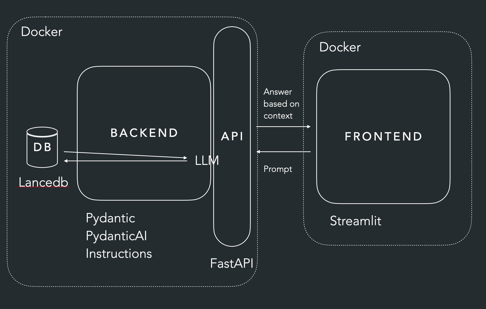

# ragbit

Separate repo for lectures 11–12 – RAG and dockerizing in the AI-OPS course.

## Setup

### 1. Initialize the project

Create the root project (a workspace root without its own package):

```bash
uv init --no-package --python 3.13
```

### 2. Create workspace packages

Separate packages for the backend and frontend, so they can be dockerized independently:

```bash
uv init --package backend
uv init --package frontend
```

### 3. Add dependencies

Add the dependencies in each package's `pyproject.toml`, and also in the root `pyproject.toml`.

### 4. Install everything

```bash
uv sync --all-packages
```

## Dockerizing



### 1. Create Dockerfiles

Put one Dockerfile per service in the `dockerfiles/` folder, e.g. `dockerfiles/frontend.dockerfile` and `dockerfiles/backend.dockerfile`.

Example (frontend):

```dockerfile
FROM python:3.13-slim

# Create /app in the root of the container and move into it
WORKDIR /app/

# Copy the frontend folder to /app/frontend (we are still in /app)
COPY frontend frontend

# Instead of installing the package, keep the folder structure as it is
# so that the imports keep working
ENV PYTHONPATH=/app/frontend

# Install uv
RUN pip install --no-cache-dir uv

# Move to the folder with the files we want to run (app.py)
WORKDIR /app/frontend/src/frontend

# Install the dependencies (without dev packages)
RUN uv sync --no-dev

# Start the app
CMD ["uv", "run", "streamlit", "run", "app.py", "--server.port=8501", "--server.address=0.0.0.0"]
```

### 2. Create `docker-compose.yml`

```yaml
services:
  backend:
    container_name: backend
    build:
      context: .                                   # this folder
      dockerfile: dockerfiles/backend.dockerfile
    ports:
      - "8000:8000"
    env_file:
      - .env                                       # injected into the container at runtime, not baked into the image
    image: backend:v1

  frontend:
    container_name: frontend
    build:
      context: .
      dockerfile: dockerfiles/frontend.dockerfile
    ports:
      - "8501:8501"
    depends_on:
      - backend
    environment:
      - API_URL=http://backend:8000                # app.py must read API_URL so the address is correct
    image: frontend:v1
```

> **Note:** Inside Docker, the frontend reaches the backend via the service name (`backend`), not `localhost`.

### 3. Build and run

```bash
# Build and start everything in the background
docker compose up -d

# Rebuild and restart only the frontend
docker compose up -d --build frontend
```

Then open:
- Frontend: http://localhost:8501
- Backend: http://localhost:8000

## Useful Docker commands

### Inspect

```bash
docker ps                    # running containers
docker ps -a                 # all containers (including stopped)
docker images                # list images
docker logs backend          # show logs for a container
docker logs -f backend       # follow logs live
docker exec -it backend sh   # open a shell inside a running container
```

### Start / stop

```bash
docker compose stop          # stop all services
docker compose start         # start them again
docker compose restart backend
docker stop backend          # stop a single container
```

### Remove containers

```bash
docker rm backend            # remove a stopped container
docker rm -f backend         # force remove (stops it first)
docker container prune       # remove all stopped containers
docker compose down          # stop and remove containers + network for this project
```

### Remove images

```bash
docker rmi backend:v1        # remove an image (its containers must be removed first)
docker rmi -f backend:v1     # force remove
docker image prune           # remove dangling (untagged) images
docker image prune -a        # remove all images not used by a container
docker compose down --rmi all   # stop everything and remove the images too
```

### Clean up everything

```bash
docker system prune          # remove stopped containers, unused networks, dangling images
docker system prune -a       # same, but also all unused images (use with care!)
```